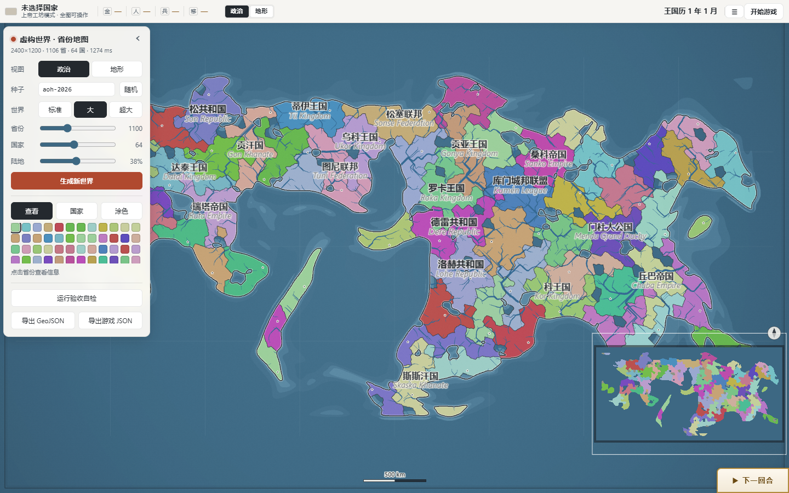
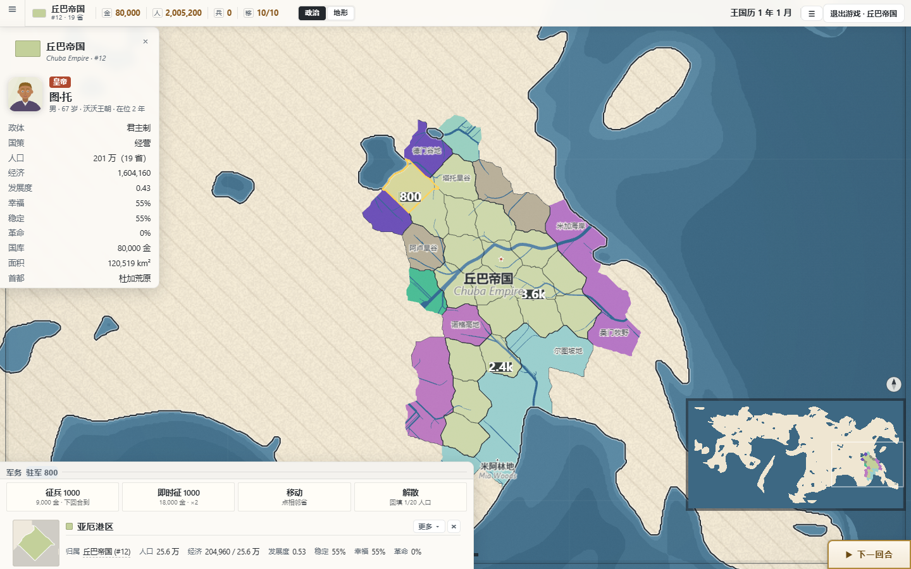

# 山河纪 · 一个种子，一个世界，一百年

浏览器里跑的程序化世界生成器 + 回合制大战略沙盒。**零依赖、零构建**：
双击 `index.html` 就能玩（`file://` 直接运行，不用起服务器）。

> 选一个种子，生成一个世界；选一个国家，活过一百年；最后得到一本只属于你的编年史。

> **规则已整体切换到《文明时代2》**（唯一口径 = `规则书-文明时代2.md`）。旧的自研机制
> （官员 / 七种资源 / 工艺军事链 / 信仰 / 情报署 / 上解）已退役。
> **想玩旧版**：`git checkout legacy-v19`（或解压仓库根的 `legacy-v19-快照.zip`）。





---

## 现在能玩到什么（阶段五：山海）

> 规则已整体切到《文明时代2》，旧的自研机制（官员 / 七种资源 / 工艺军事链 /
> 信仰 / 情报署 / 上解）**已退役**。当前是任务书里的**阶段五**（也是最后一段）：
> 地图上还有没主的地可以去殖民，瘟疫会自己走，国运有浪头，边界之外要靠眼睛 ——
> 殖民三方式、疾病十七种、地形两表、黄金时代、迷雾三档、AI 完全体。

| 层 | 内容 |
|---|---|
| **世界生成** | 种子 → 2400×1200 地图 / 约 1100 省 / 64 国；同种子逐字节可复现（平台层，未改） |
| **省份** | 人口（按国籍构成的表，现阶段全本国）/ 经济（岗位，上限=人口）/ 发展度（0.01~2.0）/ 稳定（1~100%）/ 幸福（0~100%）/ 增长 / 革命风险 / 核心归属表 / 省份价值 |
| **国家** | 国库 / 贷款 / 税率滑条（上限由政体决定）/ 四条预算滑条（税收·物资·科研·投资）/ 政体（九种系数表已落地，本阶段全体君主制）/ 移动点 / 外交点 |
| **回合结算** | 省收入（经济×税率 + 生产）→ 国库 → 行政费 + 军费（本阶段无兵=0）+ 贷款利息 → 物资满意度 → 幸福 → 稳定 → 人口/经济/发展度增长（自然增长到 1.0 封顶） |
| **敕令** | 节日（每 2 万人口 +0.1 幸福，每人 0.02 金）· 投资经济（上限=人口）· 投资发展（≥1.0 的唯一手段）—— 都花移动点 |
| **军队** | 省上一个数字：征兵扣金 + 扣人口（单省上限 1/10~1/5）、即时征 ×2 价、解散只回填 1/20；军费 0.5 金/兵/回合，厌战会把它撑大 |
| **战争** | 宣战耗外交点、开局 5 回合禁、关系 −100 = 战争；邻接移动按地形花移动点；战斗按兵力结算，守方吃地形 + 政体防御加成；空省 ≥10 兵即占；占领省画斜线阴影、原主收入归零、占领者 ~10 金/回合、不能募兵下敕令、大军损毁当地人口经济 |
| **和谈** | 战争分 = 占领比例；白和平 / 割地被占省 / 赔款；偏向 100 → 全接受；和约后停战 30 回合 |
| **人心** | 人口按**国籍构成**（打下来的省还是原国籍）；同化敕令渐进转国籍（旧核心不删）；革命风险 = 低幸福 + 低稳定 + 异族 + 厌战 + 被占领 − 驻军；风险 ≥80 每回合 10% 举旗 → **叛军国**（与所有人敌对、起源省带兵）；全国幸福连续 20 回合低位 → **内战**一分为二 |
| **政体** | 九种全表（税上限 / 物资 / 投资 / 行政费 / 研究成本 / 移动 / 募兵 / 军费 / 防御）；换政体花金、受时代门槛限制，系数**当场生效** |
| **建筑** | 八种（农场 / 工坊 / 图书馆 / 大学 / 城堡 / 瞭望塔 / 港口 / 军械库 / 补给营地，图书馆→大学是一条链的两级）；等级上限、地形与科技前置、造价随同种数量递增（**在建不计入**，批量建更便宜）、一个省一次只干一件 |
| **科技** | 研究进度 → 科技点（100:1）→ 科技等级 0.01~50，越升越贵；每级 +1% 收入 / +1% 战力 / +0.5 省防御 / 每 5 级 +1 移动点；图书馆另按人口给研究速度（封顶 +60%） |
| **外交** | 关系 −100~+100（−100 = 战争）；**21 种动作**：改善 / 侮辱 / 送礼 / 宣战 / 备战 / 和谈 / 同盟 / 互不侵犯 / 防御条约 / 保障独立 / 通行权（给与求）/ 贸易 / 索取附庸 / 索取吞并 / 释放附庸 / 支持叛军 / 联合统治 / 迁都 / 最后通牒 / 解除同盟 |
| **附庸** | 三途径（和约附庸化 / 最后通牒 / 释放复国）；附庸税 20%；独立欲望随时间涨、宗主战时涨更快，满 100% 起兵；关系 100 吞并必成 |
| **贸易** | 七类：金币（给/索）/ 省份（购省价 40000×价值，AI 永不卖核心省）/ 条约 / 拉人参战 |
| **殖民** | 开局 4.5% 的省是**无主边地**（苔原/沙漠/沼泽那一圈，土著记在人口表 0 号位）；军队进不去，只能殖民：殖民者 1,000 金移 1,000 人 / 殖民地 10,000 金立即归你（要先有 10% 本国人口）/ 本国占比 ≥10% 后**自然殖民**自己长人、过半即并入 |
| **疾病** | 十七种病照规则书原表（瘟疫 1200 省·10%·1~10% 治愈 … 营养不良）；传播率 = 该病已感染省占比 + 1%；杀伤在感染那一下一次性结算（发展度、科技减伤），患病期间稳定 −18；治愈率 0.1%~10%/回合 |
| **地形两表** | 维基表三列（防御 / 移动 / 增长）已在阶段二落地，本阶段补上萌娘表的**维护费 / 建造费**两列；丘陵增长「×1.25 还是 ×1.5」实测定案取 1.25（见规则书 18.1） |
| **黄金时代** | 每回合 0.4% 触发、持续 24 回合：科技型研究点 ×1.5，繁荣型收入 ×1.15 且幸福 +5；国卡上能看到还剩几回合 |
| **迷雾三档** | 新局规则（规则书第十九章）：1 档全图可见 / **2 档边境可见（默认）** / 3 档只本国；瞭望塔揭开一圈邻省、驻军所在实时；探过的地方留"最后一次看见的样子"，8 / 20 回合起泛黄两档；档位跟着存档走 |
| **AI 完全体** | 四种性格（经营 / 扩张 / 外交 / 殖民）按国固定，权重乘在宣战与殖民的门槛上；会派殖民者、会买断殖民地，侵略度仍按规则书 75% |
| **大国** | 世界人口前 10：税收 +5%、外交点 +2/回合、移动点 +1 |
| **存档** | v7（含军队 / 关系 / 停战 / 厌战 / 疫病 / 殖民进度 / 黄金时代 / 迷雾档位与已探地图）；v6 及以下的旧档**拒读**并提示 `git checkout legacy-v19` |
| **保留的平台** | 世界生成 / 渲染 / 地图交互 / 涂色 / 编年史 / 纪要 / 零依赖 |

## 怎么跑

双击 `index.html`。没有 `npm install`，没有打包步骤，也没有外部网络请求
（图标全是本地 PNG / 内联 SVG）。

- 面板左上「种子」+ 三个滑杆（省份 / 国家 / 陆地占比）→ **生成新世界**
- 右上「开始游戏」→ 选一个国家 → 之后每回合点「下一回合」
- 存档 / 读档走 `localStorage`：`file://` 下有些浏览器会禁用它，面板上会置灰并说明

## 目录

```
index.html            全部界面与样式（含 UI 骨架）
js/00-core.js         种子随机 / 数学 / 形态学（无 DOM）
js/01..06             噪声 · 地形 · 种子 · 分区 · 河流 · 几何 · 邻接
js/07..09             政治（国家 / 领袖 / 信仰）· 命名 · 导出
js/10-render.js       画布渲染（底图烘焙、视图、小地图、战争层）
js/11-ui.js           全部交互与卡片（阶段一：省卡 / 国卡 / 敕令 / 存档）
js/12-selftest.js     生成器自检
js/13-main.js         装配与启动
js/14-labels.js       注记排版
js/15-aoc2.js         **AoC2 核心**：数据模型 / 回合结算 / 敕令 / 定义区（改数字来这里）
js/15-resources.js    旧制的数值定义区（经济那一半已退役，只留战争/外交/编年史几块）
js/16c-aoc2-world.js  **山海层**：殖民 / 疾病 / 地形两表 / 黄金时代 / AI 性格（定义区在这里）
js/16-events.js       事件与信仰（旧制，未接）
js/17-chrono.js       编年史
js/18-ai.js           敌国内政 AI（决策层，只读 AO.res*）
assets/               资源与建筑图标
test/                 回归测试与数值 bench（puppeteer 驱动）
tools/                图标生成脚本
DESIGN*.md            每一层的设计说明（数值为什么是这些数）
```

## 测试

```bash
node test/check.js        # 生成器 + AoC2 省模型自检，纯 Node
node test/aoc2-core.js    # 阶段一验收：结算顺序 / 加税→幸福降 / 投资上限 / 发展度封顶 / 三敕令 / 旧档拒读
node test/aoc2-war.js     # 阶段二验收：征兵 / 移动 / 宣战 / 地形防御 / 占领 / 战争分 / 和谈 / 完整链路 / 厌战 / 存档
node test/aoc2-people.js  # 阶段三验收：国籍/核心 / 同化 / 革命风险 / 叛军国 / 内战 / 政体九种 / 存档
node test/aoc2-court.js   # 阶段四上：建筑八种（地形/沿海/科技前置/造价递增/工期/九种效果）+ 科技
node test/aoc2-diplo.js   # 阶段四下：21 种动作 / 最后通牒 / 附庸税与吞并 / 联合统治 / 贸易 / 大国
node test/aoc2-world.js   # 阶段五：中立省与殖民三方式 / 疾病传播与治愈 / 地形两表 / 黄金时代 / AI 性格 / 存档 / 复现性
```

其余用 puppeteer 驱动无头 Chrome（`node test/<名字>.js`）：

| 脚本 | 覆盖 |
|---|---|
| `test/paint.js` | 涂色改归属 / 国卡省卡重渲染 |
| `test/interact.js` | 点选 / 换种子 / 换视图 |
| `test/narrow.js` | 窄屏版面（省卡铺满 / 层级） |
| `test/labels.js` | 注记排版与性能 |
| `test/chrono.js` | 编年史 46 项（含 v7 存档往返、旧档拒读） |
| `test/shot.js` · `test/hill.js` | 截图与山体阴影 |

探针（`diag/`，不进仓库）：

```bash
node diag/aoc2-idle-probe.js 100   # 全 AI 挂机：国库 / 幸福 / 稳定分布 + 宣战/和约/灭国次数
node diag/aoc2-war-smoke.js        # 战争链路冒烟：征兵 → 移动 → 宣战 → 攻占（含截图）
node diag/aoc2-people-smoke.js     # 人心冒烟：国籍 / 同化 / 政体九宫格 / 强制叛乱（含截图）
node diag/aoc2-court-smoke.js      # 庙堂上冒烟：建筑九格 / 科技块 / 工地推进（含截图）
node diag/aoc2-diplo-smoke.js      # 庙堂下冒烟：外交页 21 个动作 / 切换邻国（含截图）
node diag/aoc2-vassal-ui.js        # 附庸到吞并的界面全链路（含截图）
node diag/aoc2-smoke.js            # 冒烟：生成 → 省卡 → 国卡 → 滑条 → 5 回合 → 存档
node diag/aoc2-500.js 500          # **总平衡**：全 AI 挂机 500 回合，九条判据（国库/灭国/叛乱/增长/边地/疫病/黄金时代）
node diag/aoc2-world-ui.js         # 山海冒烟：迷雾三档 / 无主省殖民卡 / 疫病行（含截图）
node diag/aoc2-terrain-probe.js    # 地形存疑项实测：丘陵增长 ×1.25 vs ×1.5
```

> 说明：`test/*.js` 里的 `require('puppeteer')` 写的是本机 workspace 的绝对路径，
> 换机器请改成自己的 puppeteer 安装位置（或 `npm i puppeteer` 后改成裸模块名）。

## 设计文档

- [`DESIGN.md`](DESIGN.md) —— 总纲：从地图到游戏
- [`DESIGN-RESOURCES.md`](DESIGN-RESOURCES.md) —— 资源 / 科技 / 治理 / 数值
- [`DESIGN-BUILDINGS.md`](DESIGN-BUILDINGS.md) —— 建筑与图标
- [`DESIGN-WAR.md`](DESIGN-WAR.md) —— 战争层（阶段二：军队 = 数字 / 战斗 / 占领 / 和谈）
- [`DESIGN-PEOPLE.md`](DESIGN-PEOPLE.md) —— 人心层（阶段三：国籍 / 同化 / 革命风险 / 叛军 / 内战 / 政体）
- [`DESIGN-COURT.md`](DESIGN-COURT.md) —— 庙堂层（阶段四：建筑 / 科技 / 外交 21 种 / 附庸 / 贸易 / 大国）
- [`DESIGN-WORLD.md`](DESIGN-WORLD.md) —— 山海层（阶段五：殖民 / 疾病 / 地形 / 黄金时代 / 迷雾三档 / AI 性格）
- [`DESIGN-FOG.md`](DESIGN-FOG.md) —— 战争迷雾与情报署（含 §11 世界消息的延迟送达）
- [`DESIGN-AI.md`](DESIGN-AI.md) —— 敌国内政 AI
- [`DESIGN-MILL.md`](DESIGN-MILL.md) —— 军工产线（三坊产能 / 工匠 / 装备；v19 起产能口径搬到 DESIGN-CRAFT）
- [`DESIGN-CRAFT.md`](DESIGN-CRAFT.md) —— 制造工艺（科技只卖材质 / 类型×材质×品质×词条 / 全国三池 20 线 / 武库 / 换代回收 / 兵器图标矩阵）
- [`DESIGN-LIFELINE.md`](DESIGN-LIFELINE.md) —— 经济续命（淘金场 / AI 卖货 / 库存闸 / 省库上解 / 缺矿开矿）
- [`DESIGN-BALANCE.md`](DESIGN-BALANCE.md) —— 保留座数（每城停几座）与平衡分析面板

## 状态

阶段五（山海）已完成，任务书的六个阶段全部走完：世界生成 → 选国 → 回合推进 →
预算滑条 → 敕令 → 建筑 → 科技 → 征兵 → 行军 → 宣战 → 攻占 → 和谈（含附庸化）→
同化 → 21 种外交动作 → 附庸 → 吞并 → 贸易 → 换政体 → 殖民 → 疫病 → 黄金时代，
整条链路都通。AI 会自己招兵、宣战、进攻、割地/附庸求和、经营关系、签同盟与
互不侵犯、研究科技、盖建筑、派殖民者。

总平衡实测（`node diag/aoc2-500.js 500`）：64 国跑满 500 回合，国库无一国爆负、
无一国灭、边地在前 200 回合被瓜分完、疫病爆发 4 场（峰值 17 省）、黄金时代 137 次；
已知项：叛军国会常驻在 6 个上限（阶段三留下的平衡问题）、幸福中位从 55 掉到 35
（AI 一路加税到政体上限）。

纯前端、无后端、无遥测、不联网。AoC2 的数值分四处：`js/15-aoc2.js`（骨架 / 战争 / 人心）、
`js/16-aoc2-court.js`（建筑 / 科技）、`js/16b-aoc2-diplo.js`（外交 / 附庸 / 贸易）、
`js/16c-aoc2-world.js`（殖民 / 疾病 / 地形 / 黄金时代 / AI 性格），
规则书没给的占位值都标了 `占位：规则书未给出` 或 `占位`。
